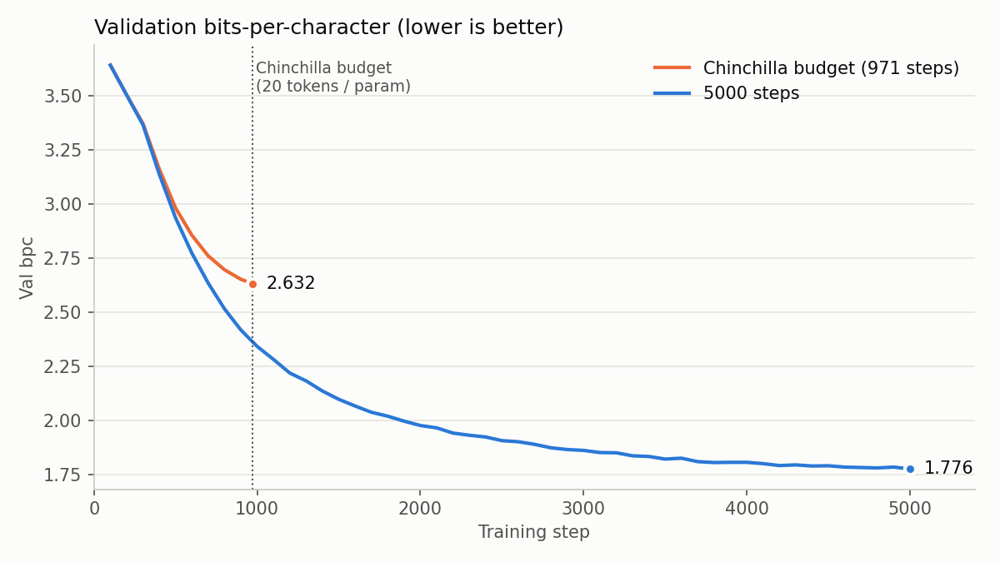

# MiniGPT: a character-level GPT trained on Dostoevsky

A decoder-only Transformer written from scratch in PyTorch and trained on an Apple M4 GPU on three Dostoevsky novels. The project sizes the model with the **Chinchilla scaling rule**, then shows what happens when you train past that budget in a data-limited setting.

| Run | Steps | Data epochs | Train time | Val bpc | **Test bpc** |
|---|---|---|---|---|---|
| Chinchilla budget (20 tokens / param) | 971 | 4 | 4 min | 2.632 | **2.611** |
| Extended training | 5,000 | 20.6 | 25 min | 1.776 | **1.754** |

Training 5× longer than the Chinchilla budget cut test bits-per-character by **33%**, with no sign of overfitting (train/val gap: 0.014 nats).



## Sample output

Prompt: `Raskolnikov looked at`. Both samples use seed 1 and temperature 0.8, and are copied unedited.

**After 971 steps (Chinchilla budget)**
```text
Raskolnikov looked at met e and the prate.
He dor to it leecing it his wre oning it minsoly, and all sight?”
“You much all sed so mes the kin aske a ther scome. I on’t whave
it, you... whis was riel a call forse, and not blatemion had the wre
```

**After 5,000 steps**
```text
Raskolnikov looked at the end, but for the extremely, and enight
to him reading him at moment to all him, and went on the “soul.”

“Kolya was all that he said,” Ivan called his brother. “Aftact, he was
concluded the agnificantly of his two wronguish straight and impatience at
once to the generous and obcare than he had been a word, there was a
fact, something heart to know her goans in again.
```

The longer run spells most words correctly, formats dialogue properly and uses real character relationships ("Ivan called his brother", Kolya). It still drifts in meaning after a sentence or two, which is expected at 0.84M parameters.

## Evaluation

All numbers below are measured on the held-out test set. Run [evaluate.py](evaluate.py) to reproduce them.

| Model | bpc ↓ | Top-1 acc | Top-5 acc | Valid words in generated text |
|---|---|---|---|---|
| Baseline: always predict most common char | 4.474 | 16.5% | 45.3% | - |
| Baseline: bigram (previous char only) | 3.529 | 27.5% | 67.4% | - |
| MiniGPT, 971 steps (Chinchilla) | 2.603 | 45.7% | 81.0% | 67.5% |
| **MiniGPT, 5,000 steps** | **1.749** | **62.3%** | **89.3%** | **95.8%** |
| Reference: real Dostoevsky test text | - | - | - | 99.2% |

- **Top-1 / Top-5 accuracy:** how often the true next character is the model's first guess, or among its 5 most likely guesses.
- **What the baselines show:** the model more than doubles the bigram's top-1 accuracy (62.3% vs 27.5%). So it uses the 256-character context, not just the previous character.
- **Valid words:** the percentage of words in 20 generated samples (500 characters each, temperature 0.8) that appear in the training text. This metric is lenient: it ignores grammar and meaning, which still break down after a sentence or two.
- **Why bpc is the main metric:** next-character prediction has no single right answer, so 100% accuracy is impossible even for a human. bpc measures how much probability the model assigns to what actually comes next.
- **Small mismatch with the training log:** test bpc here is 1.749 vs 1.754 in the log because the two scripts cut the test set into windows slightly differently.

## Key finding: Chinchilla is compute-optimal, not loss-optimal

**Sizing the model.** [Hoffmann et al. (2022)](https://arxiv.org/abs/2203.15556) found that compute-optimal training uses about 20 tokens per parameter.

- **Why the original model didn't fit the rule.** It used the GPT-2 BPE tokenizer (50,257 tokens) and had 28.7M parameters, 90% of them in the embedding and output layers. The rule would require ~574M training tokens, but the corpus has only 1.1M.
- **The fix.** Switching to characters (99-symbol vocabulary) turns the same text into ~4M training tokens.
- **Allowing repeats.** [Muennighoff et al. (2023)](https://arxiv.org/abs/2305.16264) show that repeating data for up to ~4 epochs is nearly as good as fresh data, giving an effective budget of ~16M tokens.
- **Result.** 16M ÷ 20 ≈ **0.8M parameters**. The final model has 838,784.

**Training past the budget.** At the Chinchilla budget the model was still clearly underfitting: train and val loss were equal and both still falling. Chinchilla answers *"how should I split a fixed compute budget between parameters and data?"*. Here the constraint is data, not compute, and compute is cheap (minutes on a laptop). So continuing to train keeps paying off until validation loss stops improving. Dropout (0.1) kept the model from memorising the text over 20 passes.

Note that at step 971, the 5,000-step run is already ahead (val bpc ≈ 2.36 vs 2.63). The shorter run's cosine learning-rate schedule had decayed early, so the schedule length matters as well as the step count.

## Model

| Setting | Value |
|---|---|
| Architecture | Decoder-only Transformer, pre-LayerNorm |
| Layers / heads / width | 4 / 4 / 128 |
| Context length | 256 characters |
| Vocabulary | 99 characters |
| Parameters | 838,784 (input embedding and output head share weights) |
| Regularisation | Dropout 0.1, weight decay 0.1 on 2D weights |
| Optimiser | AdamW (β = 0.9, 0.95), 100-step warmup then cosine decay 1e-3 → 1e-4 |
| Batch | 64 × 256 = 16,384 tokens per step |
| Gradient clipping | 1.0 |

Multi-head causal self-attention is written out explicitly in [model.py](model.py) (Q/K/V projection, scaling, causal mask, softmax, head concatenation). It does not call `F.scaled_dot_product_attention`.

## Data

The data is three novels from Project Gutenberg (public domain): *Crime and Punishment*, *The Idiot* and *The Brothers Karamazov*.

- **Cleaning.** The Gutenberg header and license footer are removed from each book (~19K characters per book), so the model only learns the novels' prose.
- **Fair split.** Each novel is split 90 / 7 / 3 (train / val / test) **separately**. All three books therefore appear in every split, instead of val/test coming from the end of a single book.

| Split | Characters |
|---|---|
| Train | 3,976,213 |
| Validation | 309,264 |
| Test | 132,546 |

**Metric: bits per character (bpc)** = cross-entropy / ln 2. It is reported because character-level loss is not comparable to token-level loss. Test bpc is computed once, on the best checkpoint, over the full test set in non-overlapping windows.

## Project structure

```
config.py          all hyperparameters and the Chinchilla settings
data/prepare.py    clean, split per novel, encode characters -> data/*.bin, meta.json
data/dataset.py    (x, y) next-character windows over a memory-mapped array
model.py           MiniGPT: multi-head attention, transformer blocks, generate()
train.py           Chinchilla step budget, LR schedule, eval, checkpointing, final test
generate.py        sample text from a checkpoint
evaluate.py        test-set bpc, top-1/top-5 accuracy, baselines, generated-word validity
plot_loss.py       draws assets/loss_curve.png from logs/
logs/              full training logs for both runs
```

## How to run

Requires an Apple Silicon Mac. Training runs on the `mps` GPU only and stops with an error if it is not available.

```bash
pip install -r requirements.txt

python3 data/prepare.py                 # clean + encode the novels
python3 train.py                        # Chinchilla budget (~4 min on M4)
cp checkpoints/best_model.pt checkpoints/chinchilla_971steps.pt
MAX_STEPS=5000 python3 train.py         # extended run (~25 min on M4)
cp checkpoints/best_model.pt checkpoints/steps_5000.pt

python3 evaluate.py
python3 generate.py --prompt "Raskolnikov looked at" --length 500 --temperature 0.8
python3 plot_loss.py
```

## Limitations and next steps

- **Bigger model.** The 5,000-step run plateaued with almost no train/val gap, which means model capacity is now the bottleneck. A ~5M-parameter model (width 256, 6 layers) is the natural next experiment.
- **Pretrained baseline.** Fine-tuning GPT-2 (124M) on the same splits would show how much pretraining on general English helps compared with training from scratch.
- **Noisy validation.** Validation uses 50 random batches, so per-step val numbers are slightly noisy. The final test number is computed on the full test set.
